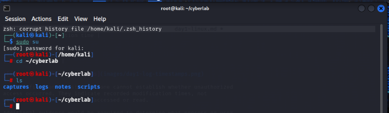
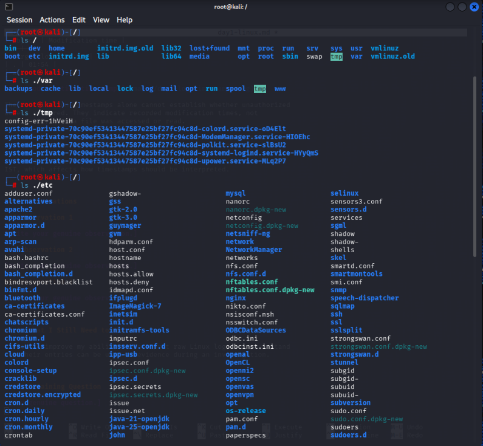
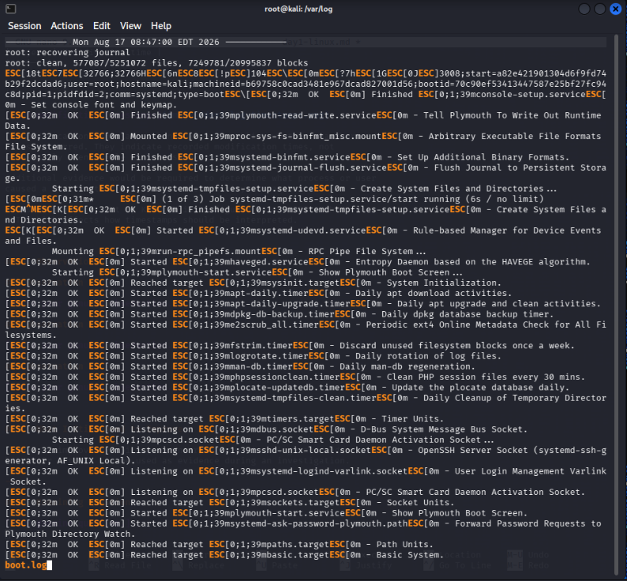
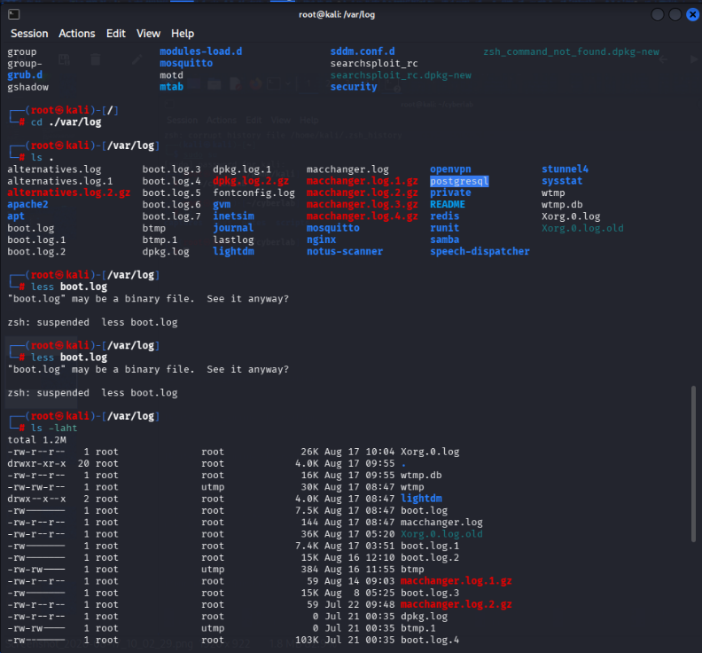

# Day 1 — Linux File System & Terminal

## Objective

To understand basic Linux file and directory management through the
terminal, become familiar with the Linux filesystem hierarchy, identify
potentially useful system information, and perform a first investigation
of Linux logs. The goal was also to begin developing the habit of
interpreting raw system information rather than simply executing commands.

---

## 1. CyberLab Structure

Created the following workspace:

cyberlab/
├── notes/
├── logs/
├── scripts/
└── captures/

---

## 2. Linux Commands Practiced

### Navigation

- `pwd` — identify the current working directory
- `cd` — navigate between directories
- `ls` — list directory contents
- `ls -a` — include hidden entries
- `ls -la` — display detailed information including permissions,
  ownership and timestamps
- `ls -lah` — display detailed information with human-readable sizes

### File and Directory Management

- `mkdir` — create directories
- `touch` — create empty files
- `cp` — copy files
- `mv` — move or rename files
- `rm` — remove files
- `rm -r` — remove directories recursively
- `clear` — clear the terminal display
- `history` — view previously executed commands

I practiced these commands by creating, moving, renaming and deleting
test files and directories within my CyberLab workspace.

---

## 3. Linux Filesystem Investigation

### /home

`/home` contains user-specific directories and files. On my Kali system,
the `kali` user's directory contains locations such as Documents,
Desktop and Downloads.

### /etc

`/etc` contains a large number of system and application configuration
files. These configurations can be relevant during an investigation
when trying to understand how a system or service is configured.

### /var

`/var` contains variable data that changes while the system operates.
Examples include logs, cached data, mail-related information and
spooled/queued data.

### /tmp

`/tmp` is used for temporary files and directories created by
applications, users and system processes. Because temporary data can
be created during normal or suspicious activity, this directory can
sometimes be relevant during an investigation.

### /var/log

`/var/log` contains logs generated by different system components and
applications. These logs can provide evidence about events and activity
occurring on the system, although their format and purpose differ.

---

## 4. Log Investigation

I examined `boot.log` to understand how raw Linux system logs represent
system activity.

One set of entries I examined was:

[ OK ] Started apt-daily.timer - Daily apt download activities.
[ OK ] Started apt-daily-upgrade.timer - Daily apt upgrade and clean activities.
[ OK ] Started dpkg-db-backup.timer - Daily dpkg database backup timer.
[ OK ] Started e2scrub_all.timer - Periodic ext4 Online Metadata Check for All Filesystems.

These entries show that several systemd timers were successfully started
during the boot process.

Examples include:

- `apt-daily.timer` — schedules daily APT download-related activity.
- `apt-daily-upgrade.timer` — schedules daily package upgrade and
  cleanup activities.
- `dpkg-db-backup.timer` — schedules package database backups.
- `e2scrub_all.timer` — schedules periodic ext4 filesystem maintenance.

The `[ OK ]` status indicates that the corresponding units were
successfully started. It does not, by itself, prove that an activity is
safe.

The entries appear consistent with normal system maintenance because
the components are recognizable systemd timers associated with routine
package-management and filesystem-maintenance tasks.

---

## 5. Modification-Time Investigation

I used a time-sorted directory listing to identify recently modified
objects in `/var/log`.

Observed:

| Object | Modification time |
|---|----|---
| Xorg.0.log | 02:07 |
| . | 01:54 |
| wtmp.db | 01:54 |

The modification timestamps alone cannot establish whether unauthorized
access occurred. They indicate recorded modification times, not
necessarily when a file was accessed or read.

Additional evidence would be required to determine what process or user
caused a modification and whether the activity was authorized.

I also discovered that my Kali VM is configured to use EDT rather than
IST, which affects how timestamps should be interpreted.

---

## 6. Observations

### Observation 1 — Linux filesystem structure

I noticed that Linux organizes information according to the purpose of the
directory. For example, `/etc` contains configuration files, while
`/var/log` contains logs generated by system components and applications.
This made me realize that knowing the filesystem structure is important
when investigating a Linux system because it helps identify where useful
evidence may be located.

### Observation 2 — Log entries require interpretation

I initially found the contents of `boot.log` difficult to understand
because they contained system messages and terminal formatting characters.
After breaking the entries into the status, component, and description, I
was able to understand that the entries represented systemd timers being
started during boot.

### Observation 3 — A timestamp is not enough to prove suspicious activity

While examining `/var/log`, I initially associated recent modification
times with possible file access. I learned that a modification timestamp
does not necessarily indicate when a file was accessed or who modified
it. Additional evidence would be required before determining whether
activity was unauthorized.

---

## 7. What I Still Need to Improve

I need to improve my ability to interpret raw Linux logs and understand
how their entries can be used as evidence during an investigation.

---

## 8. Remaining Question

I want to understand how an investigator can determine which user or
process actually caused a particular file or log entry to change, rather
than relying only on the modification timestamp.
