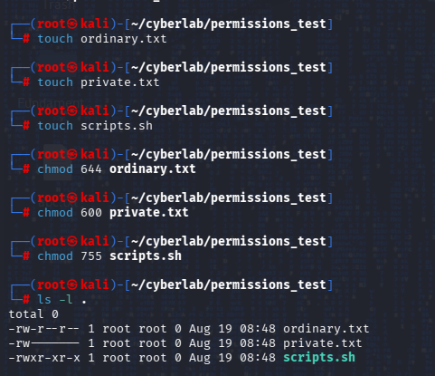
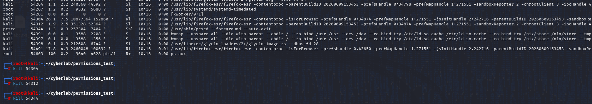
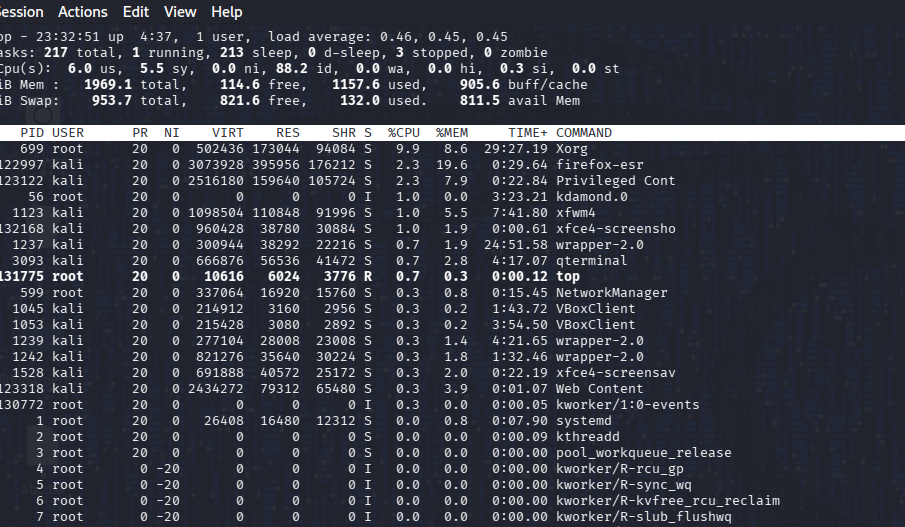
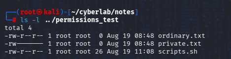

````markdown
# Week 1 — Day 2: Linux Permissions, Users & Processes

## Objective

The objective of Day 2 was to learn how to investigate Linux users, groups, file permissions, ownership, processes, and system logs from the terminal.

The main focus was on understanding who can access a file, who owns it, what processes are running, which user owns a process, and how file and process information can be used during a basic security investigation.

---

## 1. Linux User and Group Investigation

### Identity

I used `whoami` and `id` to determine the identity of the account currently being used.

The account was:

- Username: `root`
- UID: `0`
- Primary GID: `0`
- Group: `root`

Being part of a group can affect access to files and directories because permissions can be assigned to groups. Changes to group membership or group permissions can therefore change how users access files and data.

This can be useful during an investigation because understanding a user's groups can help determine what resources that account could access.

---

## 2. File Permissions and Ownership

I used `ls -l` to investigate the permissions, ownership, and other information associated with files and directories.

The permissions observed for the directories were:

```text
drwxr-xr-x
````

The first character identifies the object as a directory.

The remaining permissions are divided into three categories:

* Owner
* Group
* Others

For the observed directories:

* Owner: read, write, and execute/traverse
* Group: read and execute/traverse
* Others: read and execute/traverse

For a directory, the `x` permission allows traversal/access through the directory. It does not mean that the directory is being executed like a program.

The files inside the lab directories could be read by everyone while only the owner could modify them.

There were no files that could be written to by everyone.

The directories had execute/traverse permission, while the files I investigated did not have execute permission.

---

## 3. Controlled Permission Investigation

I created three test files and configured them with different permission levels.

### File 1

The first file could be:

* Read by the owner
* Read by the group
* Read by others

It could be modified only by the owner.

It could not be executed.

### File 2

The second file was private.

It could be:

* Read by the owner
* Written by the owner

The group and others had no permissions.

It could not be executed.

This was the most restrictive of the three files.

### File 3

The third file could be:

* Read, written, and executed by the owner
* Read and executed by the group
* Read and executed by others

Therefore, it had the broadest access of the three files.

An important security consideration is that executable permission does not necessarily mean that a file is heavily used by an organisation. It means that the users covered by the permissions are allowed to execute it.

A file with unnecessarily broad permissions may deserve investigation, especially if users who do not need access are able to modify or execute it.





---

## 4. File Ownership and Metadata

I used `stat` to investigate detailed information about a file.

The file was owned by:

* Owner: `root`
* Group: `root`

The files I investigated had a modification time of approximately:

```text
August 19, 18:48
```

File timestamps can be useful during investigations because they can help establish when activity occurred.

However, an unusual timestamp alone does not prove malicious activity. It needs to be compared with other evidence such as system activity, processes, and logs.

File metadata also contains different types of timestamps. A modification time relates to changes to file contents, while a metadata/status change time relates to changes to file metadata such as permissions or ownership.

---

## 5. Process Investigation

I used `ps` to investigate running processes.

The process information included:

* PID
* TTY
* TIME
* CMD

The PID is the identifier assigned to a running process.

The TTY represents the controlling terminal associated with the process when applicable.

The CMD column identifies the command or process being represented.

Processes observed included:

* `sudo`
* `su`
* `ps`
* `zsh`

The `zsh` process represented the shell being used.

---

## 6. Broader Process Investigation

I used `ps aux` to obtain a broader process listing.

Two processes I observed were:

### Process 1

* PID: `1`
* User: `root`
* Command: `/sbin/init splash`
* CPU: `0.0`
* Memory: `0.0`

### Process 2

* PID: `2`
* User: `root`
* Command: `kthreadd`
* CPU: `0.0`
* Memory: `0.0`

A PID allows the operating system to uniquely identify a currently running process.

Two simultaneously running processes cannot normally have the same PID, although PIDs can be reused after a process terminates.

One user can own many processes.

The user associated with a process is useful during a security investigation because it provides context about the account under which the process is running.

Processes running as `root` deserve careful attention because root has highly privileged access. However, a root-owned process is not automatically malicious because many legitimate system processes run as root.

---

## 7. Firefox Process Investigation

I opened Firefox and investigated its processes.

One Firefox process identified during the investigation had:

* PID: `46177`
* User: `kali`

I found several Firefox-related processes.

Multiple processes for one application can be normal. Modern applications may divide different tasks or components between different processes.

Therefore, seeing multiple Firefox processes does not by itself indicate suspicious activity.





---

## 8. Process Termination

I used the PID identified for the Firefox process and terminated the process.

Afterwards, I used the process listing again and could no longer find the same PID.

This confirmed that the process had terminated.

The correct PID must always be identified before terminating a process. Terminating the wrong process could disrupt an important system function or remove a process that is relevant to an investigation.

In a real investigation, process termination should therefore be performed carefully because it can also affect available evidence.

---

## 9. Real-Time Process Monitoring

I used `top` to monitor running processes in real time.

The following information changed while observing the system:

* PID
* CPU usage
* Memory usage
* User information
* Processes appearing and disappearing

`xorg` was one of the processes consuming CPU during the observation.

`xorg` and `qterminal` were also observed during the process activity.

When a new application was opened, a new process appeared in the live process listing.

When the application was closed, the corresponding process eventually disappeared.

The main difference observed between `ps` and `top` was that `ps` provided a snapshot of processes at the time it was run, while `top` continuously updated the process information.




---

## 10. `/var/log` Investigation

I investigated `/var/log` and examined `alternatives.log`.

The file had:

* Owner: `root`
* Group: `root`
* Owner permissions: read and write
* Group permissions: read
* Others permissions: read

The timestamp observed was:

```text
August 18, 01:37
```

The selected log did not provide useful readable event information during this investigation. Therefore, I could not make a reliable conclusion about its contents from this investigation alone.

This demonstrated that the filename of a log is not enough to understand what information it contains. The actual contents and format need to be investigated.

---

## 11. Observing Log Changes

While investigating `/var/log`, I observed changes involving:

* `xorg`
* `wtmp`

I observed that system activity could result in more recent timestamps appearing in logs.

The investigation showed that actions performed through the terminal and other system activity can result in changes to logs.

However, observing that a log changed after an action does not automatically prove that the action caused the specific change.

Further investigation and correlation would be required to establish a reliable connection.

The `wtmp` log also demonstrated that not every item in `/var/log` should be treated as an ordinary text file. The type and contents of a log need to be considered before deciding how to investigate it.

---

## 12. Suspicious File Investigation

I created and investigated a test file named:

```text
scripts.sh
```

Location:

```text
CyberLab/permissions_test
```

File size:

```text
0 bytes
```

Owner:

```text
root
```

Group:

```text
root
```

Permissions:

```text
rwxr-xr-x
```

Therefore:

* Owner: read, write, execute
* Group: read, execute
* Others: read, execute

Only the owner could modify the file.

The file was initially created around:

```text
August 19, 08:48
```

After I made changes to the file, its modification time changed to approximately:

```text
11:08
```

This demonstrated that changes to a file can be reflected in its timestamps.

I also investigated whether the file was associated with a running process.

When I used `ps`, I did not observe a process corresponding to the file. I also did not observe the file as a running process in `top`.

Therefore, the evidence collected during this investigation did not show that the file was currently associated with a running process.

However, I cannot conclude that the file is definitely safe or not suspicious. The correct conclusion is that no additional suspicious activity associated with the file was observed during the limited investigation performed.




---

## 13. Key Security Lessons

### File Permissions

Permissions determine who can read, modify, and execute files or traverse directories.

### Ownership

Ownership provides important context about which account and group are associated with a file.

### Users and Groups

User and group information can help determine what access an account may have.

### Processes

Processes show what is currently running on the system and which user account is associated with each process.

### PIDs

PIDs allow individual running processes to be identified and investigated.

### Timestamps

Timestamps can contribute to an investigation timeline, but they must be correlated with other evidence.

### Logs

Logs can provide evidence about system activity, but their contents and formats must be investigated before drawing conclusions.

### Evidence-Based Investigation

The absence of observed suspicious activity does not automatically prove that an object is safe. Conclusions should be limited to what the available evidence supports.

---

## 14. Three Observations

### Observation 1

Linux permissions are different for files and directories. The `x` permission on a directory allows traversal/access, whereas `x` on a file allows it to be executed.

### Observation 2

Multiple processes can belong to the same application. Firefox produced several processes during the investigation, which demonstrated that multiple processes can be used by a single application.

### Observation 3

Process information and timestamps provide useful evidence, but neither should be interpreted in isolation. A timestamp or a root-owned process by itself is not enough to establish malicious activity.

---

## 15. Remaining Question

How can Linux process information, file timestamps, and system logs be correlated to determine what user or process caused a particular change on the system?

---

## 16. Day 2 Summary

Today I investigated Linux users, groups, file permissions, ownership, metadata, processes, and logs using the terminal.

I practiced identifying my current account, examining permissions and ownership, creating different permission configurations, investigating running processes, identifying a Firefox process, terminating a controlled process, monitoring processes in real time, examining `/var/log`, and investigating a controlled suspicious-file scenario.

The main lesson was to approach Linux from an investigation perspective:

> What information do I need, which evidence can provide it, and what can I actually conclude from that evidence?

```
```
