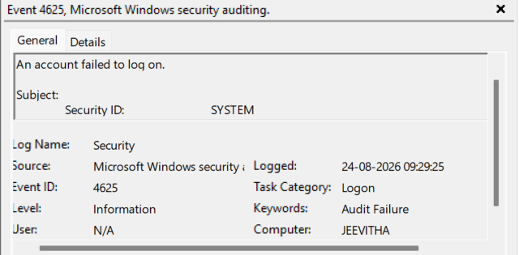
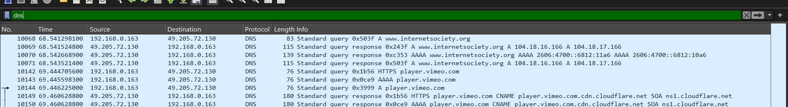

# Week 1 — Day 4: Windows Event Logs & Network Investigation

**Date:** 25-08-2026
**Focus:** Windows Event Viewer, Security Logs, DNS, TCP, TLS and ARP

---

## 1. Windows Event Viewer

### Security Logs

The Windows Security log contains security-related information such as:

* Login and logout activity
* Failed login attempts
* Process creation
* Account and security-related activity
* Information that can help investigate security incidents

Not every event is suspicious. An event becomes more meaningful when it is connected with other evidence, timing, user activity, or unusual behaviour.

### Important Event Fields

When investigating an event, the following fields are useful:

* **Event ID:** Identifies the type of event. Events of the same type generally use the same ID.
* **Date and Time:** Shows when the event occurred and helps build an investigation timeline.
* **Account/User:** Shows the account associated with the activity.
* **Computer:** Identifies the computer where the event was generated.
* **Task Category:** Gives a more specific category for the activity.
* **Keywords:** Provides a short classification of the type of security activity.
* **Subject:** Describes the account/security principal that performed or initiated the action.
* **User/Target Account:** Describes the account that was affected by the action.

The **Subject** and **Target/User** fields can therefore help determine **who interacted with whom or which account was affected by an action**.

---

## 2. Event ID 4798 — User's Local Group Membership Was Enumerated

During investigation of different Security events, Event ID **4798** was observed.

**Observed details:**

* **Event ID:** 4798
* **Time:** 25-08-2026 09:12:14
* **Account:** JEEVITHA$
* **Computer:** JEEVITHA
* **Process:** `C:\Windows\System32\svchost.exe`
* **Logon ID:** `0x2248`
* **IP Address:** Not present

### What does `$` mean?

The `$` at the end of an account name normally indicates a **computer account** in Windows/Active Directory environments.

Therefore, `JEEVITHA$` indicates the computer account rather than a normal interactive user account.

### Process

`svchost.exe` is a Windows host process used to run Windows services.

The path:

```text
C:\Windows\System32\svchost.exe
```

is the normal Windows System32 location.

The presence of `svchost.exe` does not automatically mean the activity is malicious. During an investigation, the path, parent process, command line, timing and surrounding events would need to be considered.

### Logon ID

`0x2248` is a logon/session identifier.

A SOC analyst can use such identifiers to correlate related security events that belong to the same logon session.

### Important observation

A single event does not provide the complete story. Event IDs, timestamps, accounts, processes and logon identifiers become more useful when correlated with other events.

---

## 3. Event ID 4624 — Successful Logon

While examining different Security events, Event ID **4624** was identified as a **successful logon** event.

**Observed details:**

* **Event ID:** 4624
* **Time:** 25-08-2026 06:30
* **Account:** JEEVITHA$
* **Computer:** JEEVITHA
* **Logon Type:** 5
* **Network Information:** Blank


**Screenshot:** `day4-eventviewer-4624.png`

### Logon Type 5

Logon Type **5** represents a **service logon**.

This means the logon is associated with a Windows service rather than a normal user sitting at the computer and signing in interactively.

This makes sense when investigating an account such as `JEEVITHA$` and activity involving Windows system processes/services.

### Logon Details

The logon details can help determine:

* Which account was logged into
* What type of logon occurred
* When it occurred
* Which computer was involved
* Whether network information is available
* What authentication-related information can be correlated with other events

### Logon GUID

The **Logon GUID** is a unique identifier associated with the logon session.

It can be useful for correlating the logon with other security events.

### Network Information

The network section can contain information such as the source network address and source port.

In this event, the network information was blank.

This is important because network information can sometimes help determine **where a logon originated**.

---

## 4. Investigating Failed Logons

A failed-login event was also examined.

**Observed:**

* **Date:** 24-08-2026
* **Time:** 05:29
* **Account:** JEEVITHA

Only one unsuccessful login was observed.

A single failed login is not automatically suspicious because users can make mistakes when entering credentials.

More suspicious patterns could include:

* A very large number of failed logins in a short period
* Multiple failed logins against the same account
* Multiple accounts being targeted
* A successful login immediately following many failures
* Failed logins combined with other evidence such as unusual file access or credential-related activity

The important principle is:

> **A security event becomes more meaningful when it is correlated with other evidence.**


---

## 5. Event ID 4688 — Process Creation

Event ID **4688** represents **a new process being created**.

**Observed details:**

* **Event ID:** 4688
* **Time:** 23-08-2026 08:48
* **Process:** Registry-related process
* **Creator:** System
* **Command Line:** No data found

### Parent and Child Processes

Processes can have a parent-child relationship.

The **parent process** creates or launches the **child process**.

This relationship is valuable during an investigation because it can help reconstruct how an activity started.

For example:

```text
Parent Process
      ↓
Child Process
      ↓
Another Process
```

Following these relationships can help an analyst trace related activity.

A process creation event could become suspicious depending on factors such as:

* Unusual parent-child relationships
* Unexpected processes
* Unusual execution locations
* Suspicious command lines
* Execution at unusual times
* A process being launched by an unexpected account
* Process creation occurring alongside other suspicious events
A process cannot be considered to be malicious just because it has the ID 4688.
---

# 6. Application Logs

The **Application** log was also examined.

Sources observed included:

* `igccservice`
* Office Software Protection

The Application log contained:

* Errors
* Timestamps
* Application/service sources

The events did not necessarily provide direct process information, but the **source** identifies the component that generated the event.

Application errors can become useful evidence when they occur unusually frequently or correlate with other activity.

For example:

> Could repeated errors from the same application or service indicate abnormal behaviour?

The answer would require correlation with other evidence rather than assuming that every error is malicious.

---

# 7. System Logs

The **System** log contains events related to Windows system activity.

Examples observed or considered include:

* System state changes
* Startup/shutdown activity
* Sleep/wake activity
* Service activity
* Time-related services
* Other operating-system activity

Sources such as **Service Control Manager** and **Time-Service** can provide information about system services.

System logs can therefore help establish what was happening on the machine around the time of an incident.

---

# 8. Windows Log Investigation — Key Takeaways

The Security log can provide evidence about:

* Successful logons
* Failed logons
* Process creation
* Accounts involved in activity
* Logon sessions
* Network information when available

The Application log can help investigate application and service behaviour.

The System log can help establish system and service activity.

The main investigation principle learned is:

> **Individual events rarely provide the complete story. Correlating events, accounts, processes, timestamps and network information provides stronger evidence.**

---

# 9. Wireshark Investigation

Wireshark was used to observe network traffic generated while browsing websites.

The traffic contained several protocols, including:

* DNS
* ARP
* ICMPv6
* TCP
* TLS/application traffic

DNS and ARP appeared frequently.

The main packet-list fields observed were:

* **Time**
* **Source**
* **Destination**
* **Protocol**
* **Length**
* **Info**

### Packet Fields

**Time:** Indicates when the packet was captured.

**Source:** Indicates where the packet originated.

**Destination:** Indicates where the packet was sent.

**Protocol:** Identifies the protocol being used.

**Length:** Indicates the packet size.

**Info:** Provides additional packet-specific information.

---

# 10. DNS Investigation

A DNS display filter was used to isolate DNS packets.

DNS traffic shows requests made to resolve domain names into IP addresses.

In the capture, a request related to **Mozilla Push Services** was observed.

The request was a **Type A** query.

A Type A query requests an IPv4 address.

An **AAAA** query requests an IPv6 address.



**Screenshot:** `day4-wireshark-dns.png`

### DNS Investigation

The DNS traffic showed:

1. The system sent a DNS request.
2. The DNS server received the request.
3. A response was returned.
4. The response contained address information.
5. The resolved address could then be used for the subsequent network connection.

DNS information can be useful during investigations because it can show:

* Domains requested by a system
* When requests occurred
* Which DNS server was contacted
* What IP addresses were returned
* Potential connections to suspicious or unauthorised domains
* Possible redirection or unusual DNS behaviour

### Finding the DNS Server

The destination address in the DNS packet identifies the DNS server that received the request.

Therefore, the DNS server can be identified by examining the **Destination** field of the DNS request.

---

# 11. TCP Investigation

TCP traffic was examined to understand how connections were established and terminated.

A TCP connection normally begins with a handshake:

```text
SYN
 ↓
SYN/ACK
 ↓
ACK
```

### SYN

The source sends a **SYN** packet to request the establishment of a connection.

It also contains sequence-number information used by TCP to manage communication.

### SYN/ACK

The destination responds with **SYN/ACK**, acknowledging the received SYN and indicating that it is also ready to establish the connection.

### ACK

The original sender acknowledges the response.

The connection can then proceed with data transfer.

At the end of the connection, TCP can use **FIN** and **ACK** packets to close the connection.

The direction of the initial connection is important because it identifies **which side initiated the communication**.

This can help an analyst investigate whether:

* The user's system initiated the connection.
* Another system attempted to connect to the user's system.
* A connection may have been redirected.
* Unexpected external communication occurred.

---

# 12. Ports

DNS traffic was observed using **port 53**.

HTTPS traffic normally uses **port 443**.

Ports help identify the service or type of communication associated with network traffic.

However, a port number alone should not be treated as proof of what an application is doing. It should be considered together with the protocol and other packet information.

---

# 13. TLS / HTTPS Investigation

TLS traffic was identified using Wireshark.

HTTPS traffic normally uses **port 443**.

The actual webpage contents were not visible because HTTPS encrypts the application data.

However, useful metadata can still be observed, such as:

* Source
* Destination
* Port
* Protocol
* Packet size
* Timing
* Connection patterns

Therefore:

> **Encryption protects the contents of communication, but it does not make the communication completely invisible.**

An analyst can still investigate communication patterns even when the payload itself cannot be read.

---

# 14. ARP Investigation

ARP was also observed frequently.

ARP is used on local networks to determine which device is associated with a particular IPv4 address.

A device can send an ARP request asking:

> Which device owns this IP address?

The request can be broadcast across the local network.

The appropriate device can then respond with its MAC address.

ARP therefore helps devices determine where local network traffic should be delivered.

Unusual ARP behaviour could become relevant during an investigation. For example, a device responding to requests that it should not respond to could warrant further investigation.

---

# 15. Network Timeline — Internet Society

One network connection was reconstructed from the capture.

### Step 1 — DNS Request

A DNS request was sent to the DNS server using destination **port 53**.

The system requested the IPv6 address of the Internet Society website.

### Step 2 — Second DNS Request

A second DNS request was made for the IPv4 address of the same site.

### Step 3 — DNS Responses

Responses were received for the DNS requests.

The returned IP addresses could then be used to establish the connection to the website.

### Step 4 — TCP

TCP packets appeared after DNS resolution.

The connection involved the TCP handshake:

```text
SYN
↓
SYN/ACK
↓
ACK
```

Data could then be exchanged.

### Step 5 — TLS

TLS appeared when application data was exchanged.

Because the communication was encrypted, the actual webpage contents were not visible.

### Step 6 — Connection Termination

FIN and ACK packets were observed when the TCP communication ended.

Therefore, the simplified timeline was:

```text
DNS Query
    ↓
DNS Response
    ↓
TCP Handshake
    ↓
TLS / Application Data
    ↓
Connection Termination
```

The initial communication involved the local system and the DNS server. After DNS resolution, communication could occur between the local system and the resolved server IP address.

---

# 16. Investigation Perspective

The main lesson from this investigation is that both Windows logs and network traffic provide **pieces of evidence**.

For Windows:

```text
User
 ↓
Logon
 ↓
Process
 ↓
System/Application Activity
```

For network traffic:

```text
Domain Request
 ↓
DNS Resolution
 ↓
IP Address
 ↓
TCP Connection
 ↓
TLS Communication
 ↓
Connection Termination
```

An actual SOC investigation would attempt to correlate these different pieces of evidence using:

* Timestamps
* User/account information
* Process information
* Logon information
* IP addresses
* Domains
* port
* Event IDs
* Process relationships

The objective is not simply to identify individual events, but to determine **what happened, when it happened, who/what was involved, and whether the activity was normal or suspicious**. 
---

## Day 4 Conclusion

Today I investigated Windows Event Viewer and Wireshark to understand how security and network evidence can be collected.

I investigated Windows Security events including **4798, 4624 and 4688**, along with Application and System logs.

I also investigated **DNS, TCP, TLS and ARP** traffic in Wireshark and reconstructed a network connection from DNS resolution through TCP/TLS communication and connection termination.

The main lesson was that **individual events are not automatically suspicious**. Stronger investigations come from correlating multiple pieces of evidence, especially timestamps, accounts, processes, network addresses and related events.
